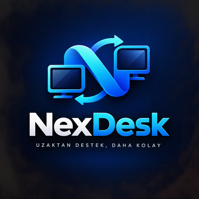

<div align="center">



# NexDesk

### Uzaktan destek, daha kolay.

Windows, Android ve tarayıcı (iPhone dahil) için **açık, güvenli ve tamamen kullanıcı onaylı** uzak masaüstü destek uygulaması.
Ara sunucuya muhtaç değil, reklam yok, arka planda casusluk yok — sadece iki bilgisayar, bir kod ve uçtan uca şifreli bir bağlantı.

<br/>


</div>

---

## 🎯 NexDesk nedir?

Birine uzaktan yardım etmek çoğu zaman şöyle başlar: *"Şu programı indir, şu hesabı aç, şu izni ver, bu pencereyi kapat..."*

NexDesk bunu kısaltır:

> **Sen kodu ver → o kodu yapıştırır → sen "izin ver" dersin → bağlanırsınız.**

Görüntü de, klavye-fare de, dosyalar da doğrudan iki bilgisayar arasında (peer-to-peer) akar. Ortada verilerinizi gören bir şirket yoktur — **kendi sunucunuzu kurmanıza da gerek yoktur.** Bağlantı kurulduğunda iki tarafta görünen **doğrulama kodunu (SAS)** karşılaştırırsanız araya kimsenin giremeyeceğinden de emin olursunuz.

Sık destek verdiğiniz bilgisayarlar için ise **rızaya dayalı gözetimsiz erişim** vardır: karşı taraf bir kez onaylar, siz sonraki sefer kimlik + parolayla doğrudan bağlanırsınız. Gizli çalışma yok — kullanıcı her an kapatabilir.

---

## ✨ Öne çıkan özellikler

| | |
|---|---|
| 🔒 **Uçtan uca şifreli** | Görüntü, kontrol ve dosyalar WebRTC (DTLS) ile şifrelenir. |
| ✅ **Her zaman onaylı** | Kodla gelen her teknisyen için ayrı "İzin Ver" sorulur; kayıtlı cihazda parola yeterlidir, bağlanan her teknisyen bildirilir ve kaydedilir. |
| 👥 **Aynı cihaza birden fazla teknisyen** | Lisans, süre ya da kişi sınırı yok. Bağlıları listeleyin, tek tek ya da toplu bağlantı kesin; fare/klavyenin kimde olduğu herkese gösterilir. |
| 📱 **Android teknisyen uygulaması** | Telefondan destek verin: dokunmatik kontrol, Türkçe karakterli yazım, özel tuşlar, monitör seçimi, kayıtlı cihazlar. |
| 🌐 **Tarayıcı / iPhone uygulaması** | Kurulum yok: sunucunuzun adresini Safari'de açın, "Ana Ekrana Ekle" — iPhone, Android ve bilgisayar tarayıcısından destek verin. |
| 📷 **Karekodla bağlanma** | Telefonla masaüstündeki karekodu okutun ya da `nexdesk://` linkine dokunun — kod yazmadan bağlanın. |
| 🖥️ **Bilgisayar kaydetme** | Oturum açıkken tek dokunuşla — Windows, Android ve iPhone'dan. Kullanıcı bir kez onaylar, sonra **kimlik + parola** ile kod sormadan bağlanılır. Her zaman kapatılabilir. |
| 🪟 **Çoklu oturum** | Tek `.exe` ile aynı anda birden fazla bağlantı; her pencere başlığında ilgili oturum kodu. |
| 🛰️ **Her ağdan bağlantı** | Kendi TURN + signaling sunucunuzla (ör. Oracle Cloud ücretsiz katman) 10 haneli kod dünyanın her yerinden çalışır. |
| 🌍 **Sunucusuz yedek yollar** | İnternet kodu (UPnP) ya da 97 karakterlik davet kodu. |
| ⚡ **Akıllı ekran aktarımı** | Yalnızca değişen 64×64 karolar gönderilir; durgun ekran sıfır trafik, yazı yazarken ~35 kat daha az veri. |
| 🧭 **Doğrudan P2P** | STUN ile doğrudan bağlantı; çok katı ağlarda isteğe bağlı TURN. |
| 🛡️ **Dolandırıcılık kalkanı** | Oturumda banka/ödeme sayfası açılırsa görüntü ve kontrol anında durur. |
| 🔑 **SAS doğrulaması** | Tek tıkla karşılaştırma; uyuşmazsa oturum hemen kesilir. |
| 🔁 **Otomatik yeniden bağlanma** | Ağ dalgalanınca oturum geri gelir; yarım kalan dosya **kaldığı yerden** sürer. |
| 🖥️ **Çoklu monitör** | Karşı taraftaki tüm ekranlar arasında geçiş. |
| 🖱️ **Uzak imleç & tıklama efekti** | Teknisyen imleci görür; kullanıcı teknisyenin nereye tıkladığını görür. |
| 📶 **Uyarlamalı kalite** | Ağ gerçekten tıkanınca 720p → 480p'ye iner, açılınca geri çıkar. |
| 🩺 **Bağlantı tanısı** | Bağlanamazsa adresleri, adımları ve olası sebebi (symmetric NAT, UDP engeli, eksik port yönlendirme…) raporlar. |
| 🧰 **Onarım paketi** | DNS, geçici dosyalar, yazıcı kuyruğu, Gezgin, winsock, sfc — tek tık. |
| 🎬 **Oturum video kaydı** | MJPEG AVI olarak kaydedilir; karşı tarafa "KAYIT ALINIYOR" gösterilir. |
| ⏺️ **Makrolar** | Yaptığınız işlemleri kaydedin, sonra tek tıkla tekrar oynatın. |
| 🔄 **Karşılıklı ekran** | Kendi ekranınızı karşı tarafa gösterin (yalnızca izleme). |
| 🤝 **Oturum devri** | Bağlantıyı koparmadan oturumu başka bir teknisyene aktarın. |
| 📇 **Adres defteri** | Etiketler, bilgisayar başına not geçmişi, Wake-on-LAN ile uyandırma. |
| 📁 **Dosya & pano** | Sürükle-bırak dosya, pano paylaşımı, 30 sn'de silinen güvenli pano. |
| 🖊️ **Ekran işaretleme** | Uzak ekrana çizip yol gösterin (çizimler solar). |
| 🕶️ **Gizlilik perdesi & giriş kilidi** | Karşı ekranı karartın, yerel klavye/fareyi geçici kilitleyin. |
| 🔄 **İmzalı otomatik güncelleme** | Windows ve Android uygulamaları yeni sürümü GitHub'dan bulur; Ed25519 imzası doğrulanmadan hiçbir dosya kurulmaz. |
| 🎨 **Tema seçimi** | Gece Mavisi · Sıcak · Aydınlık — Hakkında'dan anında, kaydedilir. |
| 🔎 **Yüksek-DPI** | %125/150 ölçeklemeli ekranlarda keskin arayüz (GDI ölçekleme). |
| 🏷️ **Beyaz etiket** | İsim, slogan, renk ve logoyu kendi markanıza göre değiştirin. |
| 🪶 **Tek dosya** | Kurulum yok. `NexDesk.exe` çalıştır, hazır. Signaling gömülü. |

### 🧭 Hangi uygulama ne yapar?

| | Destek **alma** | Destek **verme** | Kurulum | Güncelleme |
|---|:---:|:---:|---|---|
| **Windows** (`NexDesk.exe`) | ✔ | ✔ | Tek dosya, kurulum yok | Kendiliğinden (imzalı) |
| **Android** (`NexDesk.apk`) | — | ✔ | APK bir kez elle | Kendiliğinden (imzalı, bir dokunuş onay) |
| **Tarayıcı / iPhone** (`https://<sunucu>/`) | — | ✔ | Yok — Safari'de "Ana Ekrana Ekle" | Sunucuyla birlikte |

Hepsi aynı oturuma birlikte katılabilir: bir teknisyen masadan, biri telefondan, biri iPhone'dan.

---

## 🚀 Hızlı başlangıç

### İndir & çalıştır
[**Releases**](../../releases/latest) sayfasından indirin:

| Dosya | Nedir? |
|---|---|
| `NexDesk.exe` | Windows uygulaması — kurulum, .NET, ek paket **yok**; çalıştırın, hazır. |
| `NexDesk.apk` | Android teknisyen uygulaması — bir kez elle kurun (Android "bilinmeyen kaynak" izni ister). |
| `*.sig` | Güncelleme imzaları; uygulamalar kendileri kullanır. |
| `nexdesk-signaling` | Kendi sunucunuz için Linux signaling programı. |

İlk kurulumdan sonra **her iki uygulama da güncellemeleri kendisi bulur** (Windows: açılışta ve 12 saatte bir; Android: açılışta ve 6 saatte bir).

### Kaynaktan derleme
Gerekenler: **Go 1.26+**; Android için ayrıca **Android Studio** (SDK + *NDK (Side by side)*) ve Java 17.

```powershell
# Bir kez: güncelleme imza anahtarı (%USERPROFILE%\.nexdesk\update.key — YEDEKLEYİN)
go run ./cmd/nd-sign keygen -pub shared/update/update-pubkey.txt

# Sürüm: Windows exe + Linux sunucu + Android APK, hepsi imzalı
powershell -ExecutionPolicy Bypass -File .\release.ps1          # -NoAndroid: APK olmadan
```

| Betik | Ne yapar? |
|---|---|
| `build.ps1` | Yalnızca `dist\NexDesk.exe` (ikon gömülü, konsolsuz GUI). |
| `build-apk.ps1` | gomobile ile Go çekirdeğini Android kütüphanesine çevirir, Gradle ile APK'yı derler ve imzalar. SDK/NDK/Java'yı kendisi bulur; ilk çalıştırmada Android imza deposunu oluşturur. |
| `release.ps1` | İkisini + Linux sunucu programını derler, güncelleme imzalarını üretir, yüklenecek dosyaları listeler (`-Publish`: `gh` ile sürümü de oluşturur). |

> 🔑 `%USERPROFILE%\.nexdesk\` içindeki `update.key`, `android-release.jks` ve `keystore.properties` dosyalarını **mutlaka yedekleyin**. Kaybolurlarsa kurulu uygulamalar sonraki sürümleri kabul etmez.

Sürüm numarası tek yerdedir: `cmd/remotesupport/branding.go` → `appVersion` (Android sürümü de buradan okunur).

---

## 🕹️ Nasıl kullanılır?

<table>
<tr>
<td width="50%" valign="top">

### 🆘 Destek ALAN taraf
1. **"Destek Al"** kartına tıkla.
2. Ekrandaki **kodu** karşı tarafa ilet (**Kopyala** düğmesi var).
3. Bağlantı isteği gelince **"İzin Ver"** de.
4. Ekranın paylaşıldığı sürece üstte kırmızı uyarı görünür; istediğin an **"Bağlantıyı Kes"**.

</td>
<td width="50%" valign="top">

### 🧑‍🔧 Destek VEREN taraf
1. **"Destek Ver"** kartına tıkla.
2. Karşı tarafın **kodunu / internet kodunu / linkini** yapıştır — ya da **Kayıtlı Cihaz** listesinden seç.
3. **Enter**'a bas ya da **"Bağlan"** de, onay bekle.
4. **İşlemler ▾** menüsünden dosya, pano, onarım, kayıt, makro, SAS doğrulama...

</td>
</tr>
</table>

> 💡 **Güvenlik ipucu:** Bağlandıktan sonra **İşlemler ▾ → Güvenlik Kodunu Doğrula (SAS)** ile iki taraftaki 6 haneli kodu karşılaştırın. Aynıysa ✓ işareti çıkar; farklıysa oturum güvenlik için hemen kesilir.

> 🪟 **Birden fazla kişiye aynı anda destek:** Sol menüde **＋ Yeni Oturum** ile ikinci (üçüncü…) bir pencere açarsınız. Her pencere ayrı bir bağlantı yürütür ve başlığında bağlı olduğu kodu gösterir; görev çubuğunda tek grup altında toplanır.

---

## 👥 Aynı bilgisayara birden fazla teknisyen

HBYS gibi sistemlerde birkaç destek personelinin aynı anda müdahale etmesi olağandır. NexDesk'te **lisans, süre ya da bağlantı sayısı sınırı yoktur** (sunucu yalnızca kötüye kullanıma karşı oturum başına 32 kişilik bir tavan tutar).

- **Kodlu oturumda** kod, oturum sürdükçe geçerlidir; ikinci, üçüncü teknisyen aynı kodla katılır, kullanıcı her biri için ayrıca onay verir.
- **Kayıtlı cihazda** parola yeterlidir; bağlanan her teknisyen ekranda bildirilir ve denetim kaydına yazılır.
- Destek alan tarafta **Teknisyenler (N) ▾** menüsü: ad, adres, bağlı kalma süresi, son müdahale — her satırda **Kes**, altta **Tümünün bağlantısını kes**.
- Herkes kontrol edebilir; fare/klavye el değiştirdiğinde **"Kontrol: Ahmet"** herkese gösterilir, böylece iki kişi farkında olmadan aynı anda yazmaz.
- Teknisyenler oturumda başka kimlerin olduğunu görür. Biri ayrılınca oturum diğerleri için sürer; kopan teknisyen geri bağlanabilir.
- Her teknisyene ayrı şifreli bağlantı ve ayrı ekran akışı açılır (ekran bir kez yakalanır); her akışın kalitesi o teknisyenin hattına göre ayarlanır. Monitör seçimi ortaktır.

> Bu özellik signaling sunucusunun 1.4.0+ olmasını gerektirir. Eski sunucu ya da eski destek alan uygulamayla bağlantılar eskisi gibi tek teknisyenle çalışır.

---

## 📱 Android teknisyen uygulaması

Telefondan destek verin — nöbette, sahada, masadan uzaktayken.

- **Bağlanma:** destek kodu, **karekod okutma** (Google'ın sistem tarayıcısı; uygulama kamera izni istemez), `nexdesk://join…` linkleri ya da **kayıtlı cihazlar** (parolalar Android Keystore ile şifreli saklanır).
- **Dokunmatik kontrol:** dokun = tık · iki kez dokun = çift tık · uzun bas = sağ tık · sürükle = fareyle sürükleme · iki parmak = yakınlaştır/kaydır.
- **Klavye:** telefon klavyesiyle yazılanlar Unicode olarak gönderilir — Türkçe karakterler karşı tarafın klavye düzeninden bağımsız doğru çıkar. Özel tuşlar: Esc, Tab, Win, oklar, Ctrl+C/V/Z/A, Alt+Tab, F5, Ctrl+Alt+Del, kaydırma.
- **Oturum:** monitör seçimi, sohbet, "Oturumda: …" / "Kontrol: …" göstergeleri, **bağlantı bilgisi** (doğrudan/aktarmalı yol, gecikme, kare ve veri hızı, güvenlik kodu) ve **Bu bilgisayarı kaydet**. Ağ değişince kendiliğinden yeniden bağlanır.
- **Güncelleme:** yeni sürüm bulunur, indirilir, imzası doğrulanır; Android'in kurulum onayına tek dokunuş kalır.

Uygulama, Windows sürümüyle aynı Go çekirdeğini (`client/`, `shared/`, `mobile/`) gomobile ile kullanır; arayüz Kotlin/Jetpack Compose'dur (`android/`).

---

## 🌐 Tarayıcı / iPhone uygulaması

Mac, App Store ya da kurulum gerekmeden **iPhone'dan** (ve her tarayıcıdan) destek verin. Uygulama, signaling sunucusunun içine gömülüdür ve `https://<sunucu>/` adresinde yayınlanır.

- **iPhone:** Safari'de adresi açın → Paylaş → **Ana Ekrana Ekle**. Tam ekran, simgeli bir uygulama gibi açılır.
- **Bilgisayar tarayıcısı:** Fare, tekerlek ve gerçek klavye desteklenir; yazılanlar karakter olarak gider (Türkçe karakterler düzenden bağımsız), kısayollar (Ctrl+C…) tuş olarak.
- **Telefon:** Android uygulamasıyla aynı dokunmatik hareketler, telefon klavyesi, özel tuşlar, monitör seçimi, sohbet, bağlantı bilgisi ve güvenlik kodu; birden fazla teknisyenli oturumlara katılır.
- **Kayıtlı cihazlar:** Oturum açıkken **ⓘ → Bu bilgisayarı kaydet** ya da ana ekranda ＋. Parolalar tarayıcıda, dışarı çıkarılamayan bir anahtarla şifreli saklanır.
- **Güncelleme:** Sunucudaki program güncellenince uygulama da güncellenir; ayrıca dağıtım gerekmez.
- `https://<sunucu>/#code=1234567890` biçimindeki linkler doğrudan o oturuma bağlar.

**Sunucu tarafı:** `sunucu-kur.sh` web uygulamasını varsayılan olarak açar. Tarayıcılar pinli öz-imzalı sertifikayı kabul etmediği için gerçek bir alan adı ve sertifika gerekir; betik, hesap gerektirmeyen `<dış-ip>.sslip.io` adını kullanır (kendi alan adınız için `WEB_DOMAIN=destek.kurum.tr`). Sertifikayı signaling programı Let's Encrypt'ten **kendisi alır ve yeniler** (TLS-ALPN, 443 üzerinden; certbot ve 80 numaralı port gerekmez). Güvenlik listesinde **TCP 443** açık olmalıdır. Masaüstü ve Android uygulamaları pinli 8443'ü kullanmaya devam eder.

---

## 🖥️ Bilgisayar kaydetme (cihaz erişimi)

Sık destek verdiğiniz bilgisayarları bir kez kaydedin; sonraki bağlantılarda kod istemeden **kimlik + parola** ile bağlanın. Tamamen **rızaya dayalıdır** — bilgisayarın kullanıcısı açıkça onaylar ve istediğinde kapatır; gizli/sessiz erişim yoktur.

### En kolay yol: oturum açıkken kaydet (her platformda)
Kodla bağlıyken kaydetme isteği gönderin. Karşı tarafta bir **onay kutusu** çıkar; kullanıcı kabul ederse o bilgisayarda cihaz erişimi kendiliğinden açılır ve kimlik + parola şifreli bağlantı üzerinden **sizin kayıtlı cihazlarınıza** eklenir.

| Teknisyen uygulaması | Nerede? |
|---|---|
| **Windows** | **İşlemler ▾ → Bu Cihazı Kalıcı Kaydet** |
| **Android** | Üst çubukta **ⓘ (Bağlantı bilgisi) → Bu bilgisayarı kaydet** |
| **Tarayıcı / iPhone** | Üst çubukta **ⓘ → Bu bilgisayarı kaydet** |

### Elle kurulum
1. **Destek alınacak bilgisayarda (Windows):** Sol menü → **Cihaz Erişimi** → **cihaz kimliği** (varsayılan: bilgisayar adı) ve **parola** (en az 4 karakter) → **Kaydet ve Etkinleştir**. Bilgisayar arka planda sunucuya kayıtlı kalır, normal kullanılmaya devam eder.
2. **Teknisyen tarafında:**
   - **Windows:** **Destek Ver** → kimlik + parola → **Bağlan**. İlk bağlantıda cihaz **Kayıtlı Cihaz** listesine kendiliğinden eklenir; **Yönet ▾** ile yeniden adlandırılır / silinir.
   - **Android ve tarayıcı / iPhone:** Ana ekran → **Kayıtlı cihazlar → ＋** → kimlik, ad, parola.

Kayıtlı cihaza bağlanırken onay sorulmaz (parola yeterlidir); bağlanan her teknisyen bilgisayarda bildirilir ve denetim kaydına yazılır. Aynı anda başka teknisyenler de bağlı olabilir.

### Parolalar nerede tutulur?
| Yer | Nasıl? |
|---|---|
| Sunucu | Düz değil: rastgele tuz + SHA-256 özeti, sabit-zamanlı karşılaştırma. |
| Windows teknisyen | `%APPDATA%\RemoteSupport\tech-devices.json` (yalnızca bu bilgisayarda). |
| Android | Android Keystore anahtarıyla AES-GCM şifreli (anahtar telefonun güvenli donanımından çıkmaz). |
| Tarayıcı / iPhone | Tarayıcıda, dışarı çıkarılamayan (non-extractable) AES-GCM anahtarıyla şifreli. |

> Kayıtlı cihaz listesi her uygulamada ayrıdır; Windows'ta kaydettiğiniz bilgisayar telefona kendiliğinden gelmez (telefondan da bir kez kaydedin ya da ＋ ile ekleyin).

### Güvenlik
- Kalıcı erişim **tek seferlik açık bir onay** ister; SYSTEM servisi, UAC/güvenli-masaüstü ele geçirme gibi "casus yazılım" yöntemleri **yoktur**.
- Kullanıcı **Cihaz Erişimi → Kapalı → Kaydet** ile istediği an kapatır; bağlı teknisyenleri **Teknisyenler ▾** menüsünden tek tek de çıkarabilir.
- Bir Windows oturumunda cihazı yalnızca **tek NexDesk penceresi** duyurur; ikinci pencere teknisyen modunda açılır (iki pencere sunucuda birbirini düşürmez).

---

## 🌍 Bağlantı yolları

Hangi yol kullanılırsa kullanılsın, kod NexDesk'te **aynı kutuya yapıştırılır**; program türünü kendisi anlar.

| Yol | Ne zaman? | Kod | Nasıl çalışır? |
|---|---|---|---|
| 🛰️ **Sunucu üzerinden (önerilen)** | Her yer, her ağ | `591 490 5011` | Gömülü/ayarlı signaling + TURN sunucusu; doğrudan bağlantı olmazsa trafik şifreli olarak sunucudan aktarılır. |
| 🖥️ **Cihaz erişimi** | Sık bağlanılan, kayıtlı bilgisayarlar | kimlik + parola | Karşı taraf önceden açar; teknisyen kod sormadan bağlanır. |
| 🏠 **Yerel ağ kodu** | Aynı ofis/ev ağı, sunucu yoksa | `591 490 5011` | Gömülü signaling + LAN keşfi. |
| 🌐 **İnternet kodu** *(varsayılan kapalı)* | Sunucu yokken farklı şehir/ülke, ev modemi | `REQKE-2GZKC-0FZX1-S32WG` | Modemde port **UPnP ile otomatik** açılır, dış IP koda gömülür. |
| ✉️ **Davet kodu** | UPnP yok, kurumsal ağ, CGNAT | `DAVET-…` / `YANIT-…` (97 karakter) | Tamamen sunucusuz iki adımlı el sıkışma. |

### 🌐 İnternet kodu
> **1.2.0'dan itibaren varsayılan olarak kapalı.** Merkezi sunucu varken gereksizdir ve destek alan bilgisayarın 8091 portunu internete açar. Gerekirse `%APPDATA%\RemoteSupport\settings.json` dosyasına `"internet_code": true` ekleyin. Kapalıyken güvenlik duvarı kuralı TCP 8091 ve UDP 8090'ı **yalnızca yerel alt ağa** açar; 1.1'in daha geniş kuralı ilk "Destek Al"da (tek UAC onayıyla) daraltılır.

- "Destek Al" sayfasında kod oluşunca NexDesk modemde portu açar ve dış IP'yi öğrenir.
- 20 karakterlik kod **IP + port + oturum kodunu** taşır; içinde doğrulama hanesi olduğu için yanlış yazılan kod reddedilir, O/0 ve I/L/1 karışıklığı kendiliğinden düzeltilir.
- Oturum bitince modemde açılan port kapatılır.
- **Çalışmadığı durumlar** ekranda açıklanır: modemde UPnP kapalıysa 8091/TCP elle yönlendirilmelidir; operatör paylaşımlı IP (CGNAT) kullanıyorsa bu yol ulaşamaz → **davet kodunu** kullanın.

### ✉️ Davet kodu (sunucusuz el sıkışma)
1. **Destek veren:** "Destek Ver" → **Sunucusuz Bağlan (davet kodu)**. Kod ekranda seçilebilir kutuda çıkar ve panoya kopyalanır → karşıya gönderin.
2. **Destek alan:** "Destek Al" → **Davet Kodunu Yapıştır** → onay verir → ekranda bir **YANIT** kodu çıkar → geri gönderir.
3. **Destek veren** yanıtı yapıştırır → doğrudan bağlantı kurulur.

Kod yalnızca yeniden üretilemeyen bilgileri taşır: DTLS parmak izi (tam 32 bayt — güvenlik kısaltılmadı), ICE kimliğinin türetildiği kısa bir tohum ve en fazla 5 adres.

> ℹ️ Dış IP'yi öğrenmek için ücretsiz servisler (ipify vb.) ve Google STUN kullanılır; **veri bu servislerden geçmez**. İki taraf da çok katı ağdaysa (symmetric NAT) doğrudan bağlantı kurulamaz; **Ayarlar → TURN** alanını kullanın.

---

## 🛰️ Kendi sunucunuz (TURN + signaling)

Kurumsal ağlar ve mobil operatörler çoğunlukla **symmetric NAT** kullanır; bu durumda iki bilgisayar arasında doğrudan bağlantı **hiçbir yöntemle** kurulamaz. Çözüm, trafiği şifreli olarak aktaran küçük bir sunucudur. Gereken her şey `sunucu/` klasöründe:

| Dosya | Açıklama |
|---|---|
| `sunucu/sunucu-kur.sh` | Ubuntu 22.04/24.04 için tek komutluk kurulum: **coturn** (TURN, ortak sırlı) + **NexDesk signaling** (systemd servisi, şifreli `wss` + sertifika pini), port kontrolü, ufw/iptables kuralları. |
| `sunucu/nexdesk-signaling` | Linux için derlenmiş signaling sunucusu (depoda yok; aşağıdaki komutla üretin). |

```powershell
$env:GOOS='linux'; $env:GOARCH='amd64'; $env:CGO_ENABLED='0'
go build -trimpath -ldflags='-s -w' -o sunucu\nexdesk-signaling ./cmd/signaling
```

### Oracle Cloud ücretsiz katmanla 10 dakikada kurulum
1. **cloud.oracle.com** → ücretsiz hesap. *Home region* sonradan değişmez; Türkiye'ye yakın bir Avrupa bölgesi seçin (Frankfurt/Amsterdam).
2. **Compute → Instances → Create:** Ubuntu 22.04, shape **VM.Standard.E2.1.Micro** (*Always Free*), SSH anahtarını indirin.
3. Instance oluşunca public IP yoksa: VNIC → IP administration → Edit → **Ephemeral public IP**.
4. **Subnet → Security List → Add Ingress Rules** (kaynak `0.0.0.0/0`): TCP 443 (web uygulaması), TCP 8443, TCP 8091 (yalnızca geçiş döneminde), UDP 3478, TCP 3478, UDP 49160-49200.
5. Dosyaları gönderip kurun:
   ```bash
   scp -i anahtar.key sunucu/sunucu-kur.sh sunucu/nexdesk-signaling ubuntu@SUNUCU_IP:~/
   ssh -i anahtar.key ubuntu@SUNUCU_IP "sed -i 's/\r$//' sunucu-kur.sh && sudo bash sunucu-kur.sh"
   ```
6. Betiğin yazdığı değerleri NexDesk'e verin (aşağıda).

> Kendi sunucunuz (ör. kurum içi bir Ubuntu) da olur; o zaman güvenlik duvarında TCP 8443 (ve geçiş döneminde 8091), UDP/TCP 3478 ve UDP 49160-49200 bu makineye yönlendirilmeli (çıkışta port değiştirmeyen **statik NAT** ile).

### Sunucu ayarlarını NexDesk'e verme
- **Exe'ye gömmek (önerilen):** Betiğin sonunda yazdırdığı bloğu `cmd/remotesupport/assets/server-defaults.local.json` dosyasına kopyalayın (**git'e girmez** — `.gitignore`'da) ve derleyin:
  ```json
  {
    "signaling_url": "wss://SUNUCU_IP:8443/v1/ws#pin=PIN, wss://IC_IP:8443/v1/ws#pin=PIN",
    "turn_url": "",
    "turn_user": "",
    "turn_pass": ""
  }
  ```
  Ayarlar sayfasındaki alanlar boş kaldıkça gömülü sunucu kullanılır; kullanıcı kendi değerini girerse o geçerlidir. Gömülü sunucuya ulaşılamazsa NexDesk yerel ağ signaling'ine döner. Depoda yalnızca boş şablon `server-defaults.json` bulunur.
- **Elle:** Ayarlar → *İnternet Signaling* alanına aynı `wss://…#pin=…` adreslerini girin, TURN alanlarını boş bırakın. Birden fazla adres virgülle girilebilir; ulaşılabilen ilki kullanılır.

### Güvenlik modeli
- **Şifreli signaling:** Sunucu ilk açılışta öz-imzalı bir sertifika üretir. Adresin sonundaki `#pin=…` sertifikanın açık anahtar özetidir; NexDesk yalnızca bu anahtarı sunan sunucuyla konuşur, arada biri varsa *"Sunucu kimliği doğrulanamadı"* der ve bağlanmaz. Pin ağa gönderilmez. Alan adınız ve gerçek bir sertifikanız varsa (`REMOTESUPPORT_TLS_CERT/_KEY`), pinsiz `wss://alanadi/v1/ws` de olur.
- **Exe'de parola yok:** TURN parolası artık exe'ye gömülmez. coturn ortak bir sırla (`use-auth-secret`) çalışır; signaling sunucusu her **onaylanmış** oturuma 12 saat geçerli ayrı bir TURN kimliği verir.
- **Cihaz parolaları:** Gözetimsiz cihaz parolaları sunucuda yalnızca tuz + SHA-256 özeti olarak tutulur.
- **Onay penceresi:** Destek alan kişi, onay vermeden önce bağlananın bilgisayar/kullanıcı adını ve IP adresini görür. Ad karşı tarafın beyanıdır; IP sunucunun gördüğü adrestir.
- **Sürüm bildirimi:** Sunucu, bağlantıda "en son / en düşük istemci sürümü"nü bildirir. İstemci eskiyse Hakkında'da ve bağlantıda nazikçe uyarır. `MIN_CLIENT_V=2` ayarlanırsa eski (1.1.x) istemciler tamamen reddedilir.
- **Kod üretme sınırı:** Aynı IP dakikada en fazla 20 kod üretebilir.
- **Ölü bağlantı temizliği (1.4):** Sunucu 1.4+ istemcileri 30 sn'de bir yoklar; yanıt vermeyen bağlantı ~1 dk içinde düşürülür, böylece kopan bir teknisyen ya da uykuya geçen bir cihaz oturumu kilitlemez.
- **İç TURN adresi (1.3):** `sunucu-kur.sh` artık yalnızca dış adresleri dağıtır; bulut sunucunun iç adresi dışarıdan ulaşılamaz ve bağlantıyı ~8 sn geciktirirdi. Sunucuyla aynı iç ağdaki istemciler için `TURN_LAN=1` ile eklenebilir.

Sunucuda sürüm bildirimi için (isteğe bağlı):
```bash
# /etc/nexdesk/signaling.env
REMOTESUPPORT_LATEST_APP=1.5.1   # istemcilere "en son sürüm" olarak bildirilir
REMOTESUPPORT_MIN_APP=           # bundan eski istemcilere "güncelle" uyarısı (boş=kapalı)
```

---

## ⚡ Ekran aktarımı nasıl çalışır?

- Ekran 64×64'lük karolara bölünür; her karede **yalnızca değişen karolar** tek bir JPEG "atlas" içinde gönderilir, konumları JPEG yorum segmentinde taşınır.
- Ekran değişmiyorsa **hiç veri gitmez**; 5 saniyede bir ve büyük değişimlerde tam kare gönderilir.
- Yeni kare yalnızca ağ bir öncekini teslim ettiğinde üretilir (geri basınç): hat yavaşsa görüntü gecikmez, kare atlanır.
- Uzun hatlar için WebRTC veri kanalı alma penceresi 8 MB'a çıkarıldı; ölçekli (%125/%150) ekranlar gerçek piksel olarak yakalanır.
- ICE'de sanal/VPN adaptörleri (WSL, Hyper-V, VirtualBox, VPN…) elenir; böylece çok adaptörlü makinelerde doğrudan bağlantı tıkanmaz, TURN yedek olarak kalır.
- Uyarlamalı kalite, destek alan tarafta "ağ önceki kareyi yetiştirebildi mi?" ölçüsüyle çalışır.
---

## 🧰 Oturum içi araçlar (İşlemler ▾)

| Araç | Açıklama |
|---|---|
| **Dosya Gönder / sürükle-bırak** | Dosyaları pencereye bırakın. Bağlantı koparsa aktarım yeniden bağlanınca **kaldığı yerden** sürer; **iptal** edilebilir. |
| **Panoyu Gönder / Al** | Metin panosu iki yönlü. |
| **Panoyu Güvenli Gönder** | Karşıda pano geçmişine yazılmaz, 30 sn sonra silinir (şifre vb. için). |
| **Onarım Paketi** | DNS önbelleği, geçici dosyalar, yazıcı kuyruğu, Gezgin, winsock, sfc. Bazıları karşı tarafta yönetici yetkisi ister. |
| **Uzak Sistem Bilgisi** | Bilgisayar, bellek, disk özeti. |
| **Ekran Görüntüsü (F12)** | İndirilenler klasörüne kaydeder. |
| **İşaretleme Modu** | Uzak ekrana çizim. |
| **Oturumu Video Kaydet** | `Videolar\NexDesk\*.avi` — karşı tarafa kayıt uyarısı gösterilir. |
| **Makrolar** | Kaydet → adlandır → listeden tek tıkla oynat. |
| **Ekranımı Karşı Tarafa Göster** | Sizin ekranınız karşıda ayrı pencerede, yalnızca izleme. |
| **Oturumu Devret** | Karşı taraf onaylarsa yeni kod üretilir; yeni teknisyen bağlanınca sizin oturumunuz kapanır. |
| **Bu Cihazı Kalıcı Kaydet** | Karşı taraf onaylarsa gözetimsiz erişim açılır; sonraki bağlantılarda kod/onay gerekmez (Android ve tarayıcıda: ⓘ → Bu bilgisayarı kaydet). |
| **Bu Bilgisayara Not Ekle** | Not geçmişi, aynı bilgisayara bir sonraki bağlantıda otomatik gösterilir. |
| **Bağlantı Günlüğü** | Kopmalar, yeniden bağlanmalar, kalite değişimleri, SAS olayları. |
| **Gizlilik Perdesi / Giriş Kilidi** | Karşı ekranı karart / yerel girişi kilitle. |

---

## 📇 Bağlantılar sayfası (adres defteri)

Sol menüdeki **Bağlantılar** sayfası, oturum kurduğunuz her bilgisayarı otomatik kaydeder:

- 🔎 Ad, etiket veya bilgisayar adına göre arama
- 🏷️ Görünen ad ve etiketler (müşteri, şube, konum…)
- 📝 Bilgisayar başına tarihli not geçmişi
- ⏰ **Uyandır (WoL):** MAC adresi, o bilgisayar bir kez destek alan taraf olduğunda öğrenilir; aynı ağda kapalı makineyi açar.

---

## 🎨 Görünüm & güncelleme (Hakkında)

- **Tema:** **Hakkında** sayfasındaki açılır listeden **Gece Mavisi**, **Sıcak** (amber/espresso) veya **Aydınlık** temasını seçin. Değişiklik anında uygulanır ve kaydedilir.
- **Güncellemeleri Kontrol Et:** GitHub'daki son sürüme bakar; yeni sürüm varsa sorar, onaylanırsa indirir, imzasını doğrular, kendini değiştirip yeniden başlar. Oturum sürerken güncelleme yapılmaz. GitHub'a ulaşılamazsa sunucunun sürüm bildirimine bakar.

### 🔄 Güncellemeler nasıl çalışır?
1. `release.ps1` her dosya için `*.sig` üretir: Ed25519 imzası **dosya adı + sürüm + SHA-256** üzerine atılır (eski bir sürüm yeni diye sunulamaz).
2. Dosyalar GitHub'da bir **Release** olarak yayımlanır (`v1.4.1` gibi; *pre-release* işaretlenmemeli).
3. Uygulamalar `releases/latest`'i okur; imzayı uygulamaya gömülü genel anahtarla doğrulamadan hiçbir şey kurmaz. GitHub hesabı ele geçirilse bile imza anahtarı olmadan sahte güncelleme dağıtılamaz.
4. Windows'ta çalışan exe `.old` olarak kenara alınır, yenisi yerine konur ve başlatılır; eski dosya açılışta silinir. Program klasörüne yazılamıyorsa indirme sayfası açılır.

---

## 🔐 Güvenlik felsefesi

NexDesk, "kötüye kullanılamayacak" bir destek aracı olacak şekilde tasarlandı:

- 🙅 **Sessiz/gizli bağlantı yok.** Her oturum karşı tarafın açık onayıyla başlar. Gözetimsiz cihaz erişimi bile **tek seferlik açık bir onay** ister ve her an kapatılabilir; kendiliğinden başlama ya da gizli kalıcılık yoktur.
- 👁️ **Görünür durum.** Ekranı paylaşılan tarafta kalıcı "paylaşılıyorsunuz" uyarısı, kayıt sırasında "KAYIT ALINIYOR" işareti vardır.
- ✋ **Her an kesilebilir.** Tek tıkla bağlantı sonlanır.
- 🔑 **SAS doğrulaması.** Ortadaki-adam saldırılarına karşı; uyuşmazlıkta oturum otomatik kesilir.
- 🛡️ **Dolandırıcılık kalkanı.** Oturum sırasında banka, e-Devlet, kripto borsası veya ödeme sayfası öne gelirse görüntü ve uzaktan kontrol durur; kullanıcıya *"sizi arayan kişi kendini banka/polis olarak tanıttıysa bu dolandırıcılık olabilir"* uyarısıyla bağlantıyı kesme seçeneği sunulur (varsayılan: **kes**).
- 🧱 **Rol koruması.** Kontrol mesajları yalnızca doğru tarafta kabul edilir; destek alan taraf, teknisyenin bilgisayarını yönetemez ya da kilitleyemez.
- 🧯 **Güvenlik duvarı izni yalnızca onayla.** "Destek Al" ilk kez açıldığında NexDesk, Windows Güvenlik Duvarı'na kural eklemek için kullanıcıya sorar ve UAC onayı ister; sessizce kural eklemez.
- 🔒 **Güvenli masaüstüne saygı.** Ctrl+Alt+Del, UAC ve kilit ekranı sırasında paylaşım bekler, teknisyene bildirilir; kullanıcı kapatınca kendiliğinden devam eder.
- ⏱️ **Boşta kalma koruması.** Uzun süre işlem olmazsa uyarır (isteğe bağlı otomatik kesme).
- 📜 **Denetim kaydı.** Bağlantı, onay, kalıcı erişim, onarım ve kayıt olayları yerel günlüğe yazılır.

---

## 🏷️ Beyaz etiket (kurumsal marka)

NexDesk'i kendi firmanızın uygulamasıymış gibi dağıtabilirsiniz. Ayar klasörüne
(`%APPDATA%\RemoteSupport\`) bir `branding.json` bırakmanız yeterli:

```json
{
  "name": "Firma Destek",
  "tagline": "Bir tık uzağınızdayız",
  "author": "Firma A.Ş.",
  "accent": "2E90FF",
  "logo_path": "C:\\firma\\logo.png"
}
```

| Alan | Anlamı |
|------|--------|
| `name` | Uygulama adı (başlık, üst bar, hakkında). |
| `tagline` | Slogan. |
| `author` | Alt bilgide görünen "Program Yazarı". |
| `accent` | Vurgu rengi (6 haneli HEX, `#` opsiyonel). |
| `logo_path` | Özel PNG logo yolu (boşsa gömülü NexDesk logosu). |

Dosya yoksa varsayılan **NexDesk** kimliği kullanılır.

---

## 🗂️ Yerel veriler

Hepsi `%APPDATA%\RemoteSupport\` altında, yalnızca bu bilgisayarda tutulur:

| Dosya | İçerik |
|---|---|
| `settings.json` | Ayarlar (signaling, TURN, kalite, boşta kalma, cihaz erişimi, tema). |
| `tech-devices.json` | Teknisyen tarafındaki kayıtlı cihazlar (kimlik + parola). |
| `addressbook.json` | Adres defteri, etiketler, notlar, MAC adresleri. |
| `recent.json` | Son bağlantılar. |
| `netlog.log` | Bağlantı / kesinti günlüğü (2 MB'da döner). |
| `audit.log` | Denetim kaydı. |
| `macros\*.json` | Kayıtlı makrolar. |
| `crash.log` | Yakalanan hatalar. |

> Sorun ayıklarken `NEXDESK_DEBUG=1` ortam değişkeniyle başlatılırsa tüm durum mesajları da `netlog.log`'a yazılır.
> Tek makinede test ederken ikinci bir örneği `REMOTESUPPORT_NO_DEVICE=1` ile başlatırsanız o örnek cihaz olarak yayına çıkmaz (yalnızca teknisyen penceresi olur).

Video kayıtları `Videolar\NexDesk\`, alınan dosyalar ve ekran görüntüleri `İndirilenler` klasörüne gider.

---

## 🧩 Mimari

```
┌───────────────┐   1) kod: yerel / internet / davet     ┌───────────────┐
│  Destek ALAN  │       ya da cihaz kimliği + parola      │ Destek VEREN  │
│   (target)    │  ───────────────────────────────────▶  │  (operator)   │
│               │   2) tanışma: gömülü signaling (LAN,    │               │
│  ekranı yayar │      UPnP) ya da davet/yanıt kodu       │ ekranı görür  │
│               │                                         │               │
│               │   3) P2P WebRTC (DTLS, şifreli)         │               │
│  ctl │ file   │  ◀═════════════════════════════════▶    │  ekran │ ctl  │
│  screen ch.   │      görüntü · kontrol · dosya          │  file ch.     │
└───────────────┘                                         └───────────────┘
```

- **Signaling** yalnızca iki tarafı tanıştırır; oturum verisi taşımaz. `NexDesk.exe` içine gömülüdür ya da kendi sunucunuzda çalışır. Davet kodu yolunda hiç kullanılmaz.
- **TURN** yalnızca doğrudan bağlantı kurulamadığında devreye girer ve şifreli trafiği olduğu gibi aktarır; içeriği göremez.
- Kodlar onaylanana kadar **5 dakika** geçerlidir; oturum sürdükçe aynı kodla yeni teknisyenler katılabilir (her biri onaylanır). Cihaz erişimi kalıcı kimlik + parola kullanır.
- Ekran yakalama GDI `BitBlt` (imleç dahil), arayüz ham Win32 (owner-draw, çift tamponlu çizim) — ağır UI çatısı yok.

### 📂 Proje yapısı

```
NexDesk/
├─ cmd/
│  ├─ remotesupport/            # Windows uygulaması
│  │  ├─ app.go · main.go       #   giriş noktası, Win32 bağları
│  │  ├─ session.go             #   oturum akışı (destek alan / veren)
│  │  ├─ multitarget.go         #   aynı cihaza çoklu teknisyen, Teknisyenler menüsü
│  │  ├─ reconnect.go           #   otomatik yeniden bağlanma
│  │  ├─ network.go             #   ekran yayını (teknisyen başına akış), gömülü signaling
│  │  ├─ viewer.go · remote_input.go   # görüntüleyici · girdi enjeksiyonu (Unicode yazım dahil)
│  │  ├─ updater.go · update_check.go  # imzalı otomatik güncelleme
│  │  ├─ deviceaccess.go · techdevices.go · regdevice.go  # cihaz erişimi
│  │  ├─ atomicfile.go          #   atomik dosya yazımı, cihaz rolü kilidi
│  │  ├─ b1_* · b2_* · b3_* · b4_tiles.go  # araçlar, kalkan, devir, ağ, karo kodlama
│  │  └─ assets/                #   logo, ikon, gömülü sunucu ayarı şablonu
│  ├─ signaling/                # Linux signaling sunucusu
│  ├─ nd-sign/                  # güncelleme imza anahtarı üretme / imzalama
│  ├─ nd-check/ · capture-check/  # tanı araçları
├─ client/                      # capture · screen · signaling · webrtc (platformdan bağımsız)
├─ server/signaling/            # signaling mantığı (çoklu teknisyen, cihaz kaydı)
├─ shared/
│  ├─ protocol/                 #   girdi olayları
│  ├─ tiles/                    #   karo/delta kare biçimi
│  ├─ joinlink/                 #   kod · nexdesk:// link · internet kodu
│  ├─ update/                   #   GitHub sürümü, indirme, Ed25519 doğrulama, genel anahtar
│  └─ landisc/                  #   LAN keşfi
├─ mobile/                      # Android Go çekirdeği (gomobile bind)
├─ android/                     # Android uygulaması (Kotlin/Compose, Gradle)
├─ web/                         # tarayıcı / iPhone uygulaması (PWA), signaling'e gömülü
├─ integration/                 # uçtan uca testler (çoklu teknisyen dahil)
├─ sunucu/                      # sunucu-kur.sh (coturn + signaling kurulumu)
└─ build.ps1 · build-apk.ps1 · release.ps1
```

```powershell
go test ./...        # sunucu, istemci, mobil çekirdek ve uçtan uca testler
```

---

## 🤝 Katkı

Fikir, hata bildirimi ve PR'lara açığız! Bir hata mı buldunuz, bir özellik mi hayal ettiniz — issue açmaktan çekinmeyin.

---

## 📜 Lisans

MIT Lisansı altında dağıtılır. Dilediğiniz gibi kullanın, geliştirin, paylaşın.

---

<div align="center">

**Program Yazarı: Hasan Güler** · © 2026

*Uzaktan destek, daha kolay.* 💙

</div>
